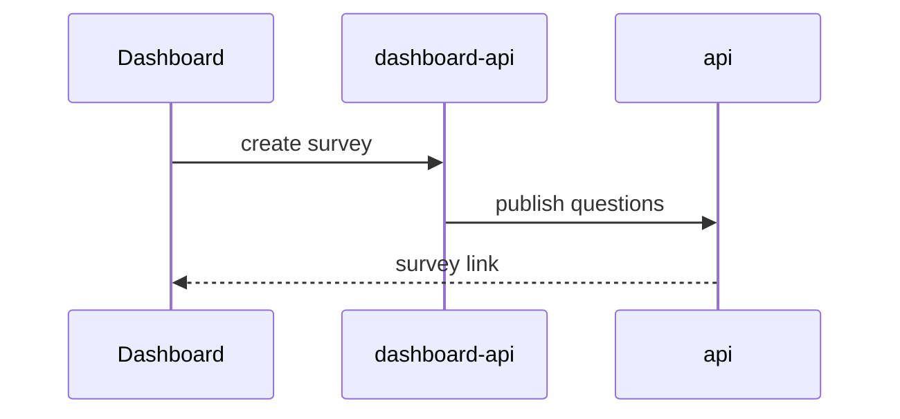

# Writing the body

Write for a reviewer who skims. Short sentences, short bullets, no preamble. If a line doesn't help someone review or test the PR, cut it.

## Length

Aim for about one screen from the top of the body to `## Evidence`. Most PRs need no visual in `## Changes`, 2–4 bullets per repo and 4–6 review steps.

## Never include

- Lint, React Doctor or typecheck fixes, translation strings, test files, moved helpers, renames and other internal refactors.
- History from earlier versions of the branch: bugs found and fixed in review rounds, removed temporary hooks, "before, this did X". Describe the final change against `master` only.
- Detail the screenshots, recording or tests already show.
- What each test file covers. The test output is the evidence.

## `### Context`

Two or three short sentences, so the reviewer knows why the PR exists before reading code:

- **Situation**: what existed before.
- **Problem**: what was missing or broken, and why it matters.
- **Fix**: what this PR does about it, in one sentence.

Skip a beat that doesn't apply. Don't manufacture filler.

**Bad:**

> Fixed formatting bug in surveys

**Good:**

> #1833 fixed "Placeholder" text in WPP surveys by clearing the matrix formatting arrays in `shiftAndInsertQuestions`. That also stripped bold, italic and underline from every matrix question. This PR restores the arrays; BOUN-10345 fixes the Placeholder mismatch properly.

## `### What changed`

A few bullets per repo. Name the endpoints, components and fields that were added or changed, not every behaviour they have.

- 2–4 bullets per repo. Start each with a verb: "Add", "Update", "Remove".
- Wrap code identifiers in backticks.
- Name new components in brackets after what they do, instead of explaining their internals.
- Mention a feature flag once, in the repo line.
- Single repo → plain bullets. Multiple repos → group by repo name with sub-bullets indented 2 spaces.

**Bad:**

```
- Fixed some stuff
- Made changes to the survey page
```

**Bad** (too much; lists every behaviour and review-round fix):

```
- Redesign `RelevantSourcesModal`:
  - the same toolbar as the Sources Library: a search box (names only), a Sort button, ...
  - a top border on the footer, and a list scrollbar that's always visible
- Escape in the Filter popover closes only the popover, not the modal.
- Fix the modal resetting itself whenever `Chat` re-rendered.
- Apply React Doctor fixes: ...
```

**Good:**

```
- **retrieval-engine-v2**: `/sources/retrieve` takes optional `tagIds` and only searches sources that carry any of them (`tag_scope.py`). Unknown, inactive or other orgs' tags get a 400. With no tags, the search is unchanged.
- **dashboard** (tag parts behind `retrieval-engine-tags`)
  - Composer: a **Tags** picker for the first question (`SearchTagsButton`, `BadgePickerPopover`), with each tag's source count.
  - `RelevantSourcesModal` redesign: the Sources Library toolbar, groups for Recommended / More in these tags / Everything else, and a footer listing the ticked sources.
  - **Start Project** saves the tags on the project (`searchTags`) and shows them under the first question.
```

### Visuals (rarely)

No visual by default. Add one only when bullets can't make the point:

- **Mermaid**: the flow crosses 3+ services in an order that isn't obvious. Not for one endpoint with a new parameter.
- **`diff`**: a contract someone else has to act on, like a shared type, request/response shape, stored document shape or config format. Not for one new optional field; a sentence covers that.
- **Pseudocode**: a non-obvious algorithm or ordering rule.
- **Table**: 3+ options or fields that change in the same structured way.

Skip component and file trees. Screenshots in Evidence show the UI better, and the diff shows the files.



```diff
 retrievalEngineV2Files/{fileId}
   name: "Q3 report.pdf"
+  tags: ["tagId1", "tagId2"]
```

## `## Evidence`

Concrete proof the change works. This is what the author already verified, unlike Functionality Review, which is what the reviewer will do.

Use execution-based evidence: tests, typecheck or lint output, console output, a `curl` response. Paste real output trimmed to the relevant lines. Only include evidence you actually ran or saw in this session or the branch history. Never invent output.

**Test runs** go in one compact block for all repos: a `#` heading per repo with the command, its trimmed output, and `---` between repos:

````markdown
- **Tests**
  ```markdown
  # dashboard-api — `jest src/routes/tags` (Firestore emulator)
  PASS src/routes/tags/index.test.ts
  PASS src/routes/tags/sourceTags.test.ts
  Tests:       150 passed, 150 total
  ---
  # retrieval-engine-v2 — `uv run pytest tests/unit`
  1363 passed
  ---
  # dashboard — `jest src/customComponents/__tests__`
  Tests:       309 passed, 309 total
  ```
````

**A bug fix** shows the specific test that failed before and passes now:

```markdown
- **Before:** `formatting.test.ts › preserves matrix formatting on shift` — fails, `rowItemsFormatting` is `[]`
  **After:** passes
```

### Recordings and screenshots (visual changes)

When the user asks for a recording or screenshots, or accepts your offer for a visual change, record them yourself with Playwright: follow `references/recording-evidence.md`. Lay out the result with a format from **Choosing visuals** below.

If the user already has screenshots of their own, ask which ones to use and which are **before** vs **after**; never guess. Copy them to `/tmp/bounce-pr/evidence/` with clean names (macOS screenshot names contain characters that break markdown links) and attach them the same way.

If the change is visual and there is nothing to attach, leave a placeholder and remind the user to drag images into the PR on GitHub:

```markdown
- **Before:** <!-- drag screenshot here -->
  **After:** <!-- drag screenshot here -->
```

If the change isn't visual and there is no execution evidence either, omit the whole `## Evidence` section.

## Choosing visuals

Pick per PR, by what the reviewer most needs to see. Most PRs need one or two of these, not all. Visuals for `## Changes` are under **Visuals (rarely)** above.

| Format | Best for |
|---|---|
| Single screenshot | A new screen or state; one look explains it |
| Before/after table | Layout, styling or copy changes; several comparisons stacked as rows |
| Walkthrough video | Multi-step flows, interactions, anything that moves |
| State grid | A component's empty, loading, error and filled states side by side |
| Permission matrix | Features that differ by role, org, team or flag |
| Data proof | Changes that write data: the stored document, or a before/after of its shape |
| API example | New or changed endpoints: a request and its response |
| Responsive pair | Changes that must work on desktop and mobile |
| Collapsible section | Long logs, extra screenshots, secondary detail |
| Metrics table | Performance work: numbers before and after |

Before/after table (GitHub renders images in table cells; add rows for more comparisons):

```markdown
| Before | After |
|---|---|
|  |  |
|  |  |
```

Permission matrix (checked roles only; say how each was verified):

```markdown
| Who | Sees tags | Can tag | Verified by |
|---|---|---|---|
| Org root | ✅ | ✅ | recording, chapter 2 |
| Read-only member | ✅ | ❌ | screenshot below |
| Another org | ❌ | ❌ | `sourceTags.test.ts` |
```

Data proof, as a shape diff:

```diff
 retrievalEngineV2Files/{fileId}
   name: "Q3 report.pdf"
   status: "indexed"
+  tags: ["tagId1", "tagId2"]
```

Or as a Firestore emulator screenshot of the stored document (see `recording-evidence.md`).

API example:

````markdown
```bash
curl -X POST localhost:1337/tags/sources/apply -d '{"items":[{"type":"file","id":"abc"}],"add":["t1"],"remove":[]}'
```
```json
{ "success": true, "updated": [{ "type": "file", "id": "abc" }], "failed": [] }
```
````

Collapsible section, so extra material doesn't push the review steps down:

```markdown
<details>
<summary>More screenshots (read-only view, other org)</summary>


</details>
```

A responsive pair is a two-column table like the before/after one, with `Desktop | Mobile` headers. Use markdown image links only: `gh --attach` rewrites `` links to the uploaded files, but HTML `` tags aren't documented to work.

When a screenshot needs a pointer, draw it into the page before capturing (`playwright-cli highlight`, or an overlay in the hero script) rather than editing images afterwards.

## `## Merge Danger`

**Door** — is the merge reversible?

- **Two-way door** — reverting the PR fully restores the old behaviour. Most UI, API logic, and refactors.
- **One-way door** — reverting leaves lasting effects. At Bounce, typical one-way doors:
  - Writes, migrations, or deletes against Firestore data (survey, response, or user documents)
  - Changes to stored data shapes in `ts-types` that existing documents will be written in
  - emulator-data schema changes other branches rely on
  - firestore-functions triggers that fire on deploy or mutate data
  - Anything sent externally: emails, webhooks, third-party API calls

**Blast Radius** — one word for scope (e.g. `isolated`, `page`, `service`, `cross-repo`, `platform`), then a short line on what could break. Consider layout shifts, mobile/responsive breakage, consumer breakage, and performance.

Bounce heuristics:

- Any `[Yes]` in Impact on Repositories → at least `cross-repo`. Name the consumers (e.g. a `ts-types` change touches every service that imports the changed type).
- Shared `dashboard-core` components → every dashboard page using them.
- `web-surveys` / `api` changes → respondents taking live surveys, not just internal users.

## `## Functionality Review`

Keep it short and generic, so the reviewer follows the main path and then tries their own edge cases. The tests and the recording cover the fine detail.

- Setup steps first: commands, branches, test accounts, data to load. Be exact here; the reviewer can't guess them.
- Then 4–6 steps. Each is one flow in one or two short sentences: do X, see Y.
- Cover the main path, one edge case, and the flag-off check if there's a flag.
- Give exact expected values only when they're the point ("**Recommended** has 4 sources"). Don't list every item, colour or keyboard behaviour.
- Name screens and buttons in **bold**. Write local service URLs as markdown links labelled with the service name: `Open [dashboard](http://localhost:3002)`, not `Open localhost`.

```
1. Run `review-tool <primary-repo> <PR_NUMBER>` to set up all services.
2. [Do the main flow] — [what you should see]
3. [Variation or edge case] — [what you should see]
```

`<PR_NUMBER>` is only known after the PR is created. Write it as a literal placeholder; it gets filled in once the PR is open.

**Bad:**

> Test the feature.

**Bad** (a QA script):

> 13. Confirm the toolbar reads search, **Sort**, **Filter**, then **Clear filters** once something is picked. Open **Filter** and tick **Equipment** under Tag. Confirm only the 3 Equipment sources show, the button shows **1**, a pink **Tag · Equipment** box shows under the search, and the footer says **3 hidden by filters**. Press Escape: only the popover closes. ...

**Good:**

> 1. Run `review-tool dashboard 1234` to spin up all services.
> 2. Open [dashboard](http://localhost:3002) and go to **Retrieval Engine**. Without picking tags, ask "What stops people from playing more tennis?". **Recommended** has 4 sources.
> 3. Start a **New Chat**, pick **Fans** and **Clubs and courts** under **Tags**, and ask a question. Only sources with those tags are recommended.
> 4. Try **Sort** and **Filter** in the modal. **Clear filters** resets both.
> 5. Click **Start Project**. The tags show under the first question, and follow-ups have no **Tags** button.
> 6. Turn the flag off. There's no **Tags** button, and the modal still works.

After drafting the steps, run the flow audit in `review-tool-format.md`.
