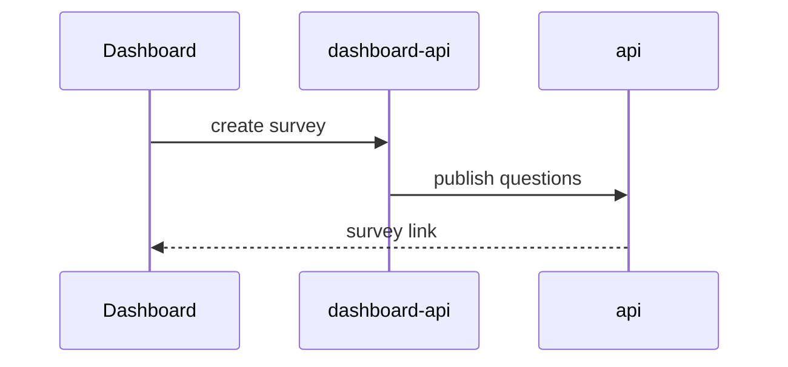

# Writing the body

Skip all preambles and keep prose brief. Every sentence should save the reviewer time.

## `### Context`

Give reviewers the picture so they understand the PR before reading code. Cover whichever beats actually apply — don't manufacture filler:

- **Situation** — what existed before, how it worked
- **Problem** — what broke or was missing, and why it mattered
- **Fix** — what this PR does about it, in one sentence

A small refactor may only need Situation + Fix. A bug fix usually needs all three.

**Bad:**

> Fixed formatting bug in surveys

**Good:**

> PR #1833 fixed "Placeholder" text rendering in WPP surveys by clearing `columnChoicesFormatting` and `rowItemsFormatting` to empty arrays in `shiftAndInsertQuestions`. This worked but had a side effect — it stripped all rich text formatting (bold/italic/underline) from matrix questions, breaking the formatting support added in #500.
>
> The proper fix for the Placeholder mismatch is handled in the companion PR (BOUN-10345), which regenerates formatting at runtime when rules overwrite options.

## `### What changed`

Lead with a visual, then follow with short bullets.

### Visual summary

Pick the smallest view that makes the key point clear.

- Show logic or an algorithm as pseudocode:

```text
on(save)
  if content is unchanged
    return cached result
  write new content
  return fresh result
```

- Show runtime control flow as a call tree:

```text
submitForm
  createSession
    persistPrompt
    launchAgent
  navigateToSession
```

- Show UI structure as a component tree, including state and module boundaries that matter:

```text
<SurveyEditor> (dashboard/src/pages/survey-editor.tsx)
  useSurveyQuestions()
  <QuestionList>
    <MatrixQuestion> (dashboard-core)
```

- Show file responsibility or a broad refactor as a shallow file tree:

```text
src/
├── rules/          # runtime answer rules
├── formatting/     # rich text generation
└── export/         # survey → editor normalisation
```

- Show cross-repo interaction, control flow, or data flow with Mermaid — the natural fit when a change spans several Bounce services:



- Use `diff` when the point is what changes and the surrounding shape already exists. Match the diff shape to the topic.

For a call-tree change:

```diff
 shiftAndInsertQuestions
   shiftQuestionIndexes
-  clearFormatting
+  preserveFormattingArrays
   insertQuestions
```

For a component change:

```diff
 <SurveyEditor>
   <QuestionList>
+    <RefreshButton />
   <QuestionPreview>
```

For a file-layout change:

```diff
 src/
 ├── rules/
+│   └── generate-formatting.ts   # rebuilds formatting at runtime
-└── formatting.ts
+└── formatting/
+    ├── matrix.ts
+    └── single-choice.ts
```

For a state or control-flow change:

```diff
 on(ruleOverwritesOptions)
-  update rowItems
+  update rowItems
+  regenerate rowItemsFormatting
```

- Show the whole block when most of it is new, when omitted context would hide ownership or order, or when the reviewer needs a copyable target shape.

Place each visual next to the short text it supports. Keep only the calls, files, props, states, and boundaries needed to understand this PR. You may use one, you may use several — it is unlikely you will use all of them. Use your judgement and don't overwhelm the reviewer. A trivial change (copy tweak, config bump) needs no visual.

### Bullets

Use a **table** instead when 3+ fields, options, or behaviors change in the same structured way.

- Start each bullet with a verb: "Update", "Add", "Remove", "Refactor", "Revert"
- Wrap code identifiers in backticks
- One clear action per bullet; don't repeat what the visual already shows
- Single repo → plain bullets. Multiple repos → group by repo name with sub-bullets indented 3 spaces.

**Bad:**

```
- Fixed some stuff
- Made changes to the survey page
```

**Good — multiple repos:**

```
- **web-surveys**:
   - Update `shiftAndInsertQuestions` to preserve formatting arrays
   - Remove dead `clearFormatting` code path
- **api**:
   - Add `generateFormatting()` helper to runtime rule execution
```

**Good — table:**

```markdown
| Where options change | Formatting updated? |
|---|---|
| mainWpp creates questions | No formatting created at all |
| exportSurveyToEditor normalizes | Yes — generates from current values |
| pipeFamiliarBrandsRule (runtime) | NO — only updates rowItems |
```

## `## Evidence`

Concrete proof the change works, shown as before and after. This is what the author already verified — distinct from Functionality Review, which is what the reviewer will do.

Use execution-based evidence: the exact test that failed before and passes now, typecheck/lint output, console output, a `curl` response. Paste real output in a fenced block, trimmed to the relevant lines.

```markdown
- **Before:** `formatting.test.ts › preserves matrix formatting on shift` — fails, `rowItemsFormatting` is `[]`
  **After:** passes
```

Only include evidence you actually ran or saw in this session or the branch history. Never invent output.

### Screenshots (visual changes only)

Screenshots are the best evidence for a visual change. The agent doesn't take them — the user does, and the agent attaches them.

1. Find candidates — images or videos in the macOS screenshot folder modified after the branch was created:
   ```bash
   git -C ~/bounce/<primary-repo> reflog show --date=iso --format='%gd' BOUN-XXXX | tail -1
   screenshot_dir=$(defaults read com.apple.screencapture location 2>/dev/null || echo "$HOME/Desktop")
   ls -lt "${screenshot_dir/#\~/$HOME}" | head -20
   ```
2. Look at each candidate (Read the image) and ask the user which ones to use and which are **before** vs **after**. Never guess the assignment. Flag any that show client data (respondent answers, client names, emails) — uploads can't be undone.
3. Copy the chosen files to `/tmp/bounce-pr/` with clean names (`before.png`, `after.png`, `after-mobile.png`) — macOS screenshot names contain spaces and non-breaking characters that break markdown links.
4. Reference them by **absolute path** in the body; `gh pr create --attach` uploads them and rewrites these links (see Step 5 in `SKILL.md`):
   ```markdown
   - **Before:** 
     **After:** 
   ```

If the change is visual but there are no screenshots, leave a placeholder and remind the user to drag images into the PR on GitHub once it's open:

```markdown
- **Before:** <!-- drag screenshot here -->
  **After:** <!-- drag screenshot here -->
```

If the change isn't visual and there is no execution evidence either, omit the whole `## Evidence` section.

## `## Merge Danger`

**Door** — is the merge reversible?

- **Two-way door** — reverting the PR fully restores the old behaviour. Most UI, API logic, and refactors.
- **One-way door** — reverting leaves lasting effects. At Bounce, typical one-way doors:
  - Writes, migrations, or deletes against Firestore data (survey, response, or user documents)
  - Changes to stored data shapes in `ts-types` that existing documents will be written in
  - emulator-data schema changes other branches rely on
  - firestore-functions triggers that fire on deploy or mutate data
  - Anything sent externally: emails, webhooks, third-party API calls

**Blast Radius** — one word for scope (e.g. `isolated`, `page`, `service`, `cross-repo`, `platform`), then a short line on what could break. Consider layout shifts, mobile/responsive breakage, consumer breakage, and performance.

Bounce heuristics:

- Any `[Yes]` in Impact on Repositories → at least `cross-repo`. Name the consumers (e.g. a `ts-types` change touches every service that imports the changed type).
- Shared `dashboard-core` components → every dashboard page using them.
- `web-surveys` / `api` changes → respondents taking live surveys, not just internal users.

## `## Functionality Review`

Write specific, numbered steps based on what was actually built. Do not write generic steps. URLs come from the service reference in `review-tool-format.md`.

```
1. Run `review-tool <primary-repo> <PR_NUMBER>` to set up all services.
2. [Navigation step — where to go first]
3. [Action step — what to do]
4. [Verification step — what to confirm/expect]
```

`<PR_NUMBER>` is only known after the PR is created — write it as a literal placeholder; it gets filled in once the PR is open.

Each step is one of:

- **Setup** — run a command or open a URL
- **Action** — click, fill in, submit
- **Verification** — "Confirm that…", "Verify that…", "Check that…" — always end with the expected result

Write local service URLs as markdown links labelled with the service name:

- **Good** — `Open [dashboard](http://localhost:3002) and go to **My Surveys**.`
- **Bad** — `Open localhost and go to My Surveys.`

**Bad:**

> Test the feature.

**Good:**

> 1. Run `review-tool dashboard 1234` to spin up all services.
> 2. Open [dashboard](http://localhost:3002) and go to **My Surveys**.
> 3. Click the refresh button and confirm it reads "Refresh this dashboard".
> 4. Verify the list refreshes after clicking.
> 5. Go to Trackers and confirm that button still reads "Refresh".

After drafting the steps, run the flow audit in `review-tool-format.md`.
